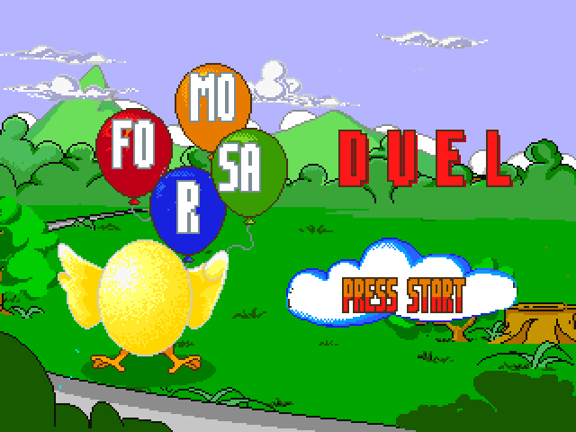
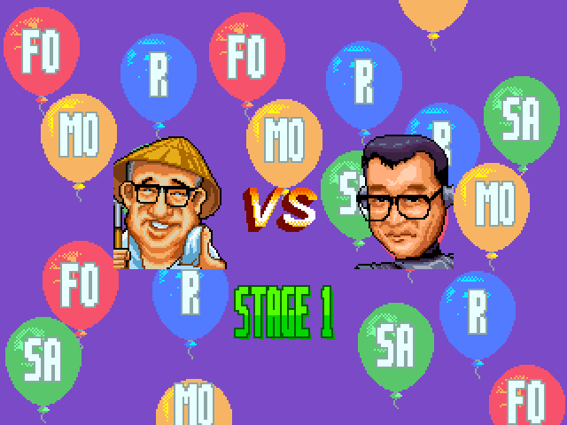
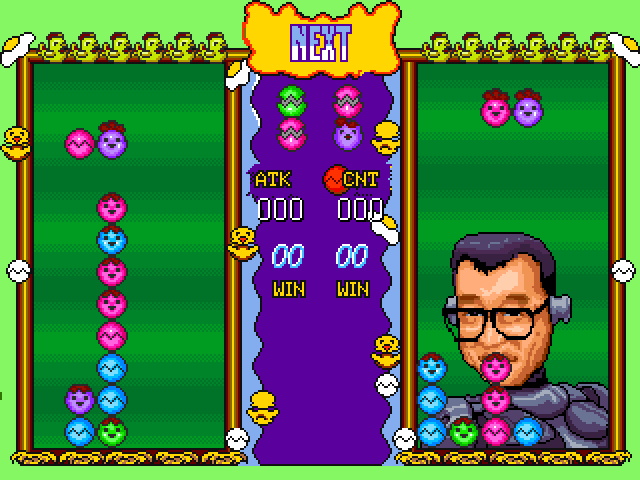

# Formosa Duel (Super A'Can) — English Translation

Proportional pixel-art / Variable-Width Font (VWF) English localization for *Formosa Duel* (`Formosa Duel (Taiwan).bin`) on the Funtech Super A'Can. All localized sprite banks and background graphics preserve the original 1 MB ROM size (`1,048,576` bytes = `0x100000`) by recompressing modified tiles into unused tail ROM space (`0x0EF8A8..0x100000`) and updating descriptor pointers in place.

## Screenshots

<p>




</p>

## How to Play

Apply `build/Formosa Duel (EN).ips` to `Formosa Duel (Taiwan).bin` (1,048,576 bytes, CRC32 `b2bf31dc`,
SHA-1 `8d0680e1322af21b20d5cee2c100b05cf4217815`, the MAME `formduel` dump). The ROM keeps its size.

- **Repo emulator:** open the patched file.
- **MAME:** put the patched file in `roms/formduel/` as `Formosa Duel (Taiwan).bin` and run
  `mame supracan formduel` (MAME warns about the checksum; that's expected).

---

## Quick Start / Build Instructions

Put your own `Formosa Duel (Taiwan).bin` in this folder, then run (requires Python 3 and Pillow):

```bash
python3 tools/build_rom.py
```

Outputs generated under `build/`:
- `build/Formosa Duel (EN).bin` — patched 1 MB Super A'Can ROM
- `build/Formosa Duel (EN).ips` — IPS patch against `Formosa Duel (Taiwan).bin` (round-trip verified by `build_rom.py`)
- `build/report.txt` — allocation map, patched address ranges, SHA-1/SHA-256 digests, and translation entry log

Supporting documentation generated alongside the build:
- `notes/text_inventory.md` — concise table of all 32 translated items and ROM locations
- `notes/translations_en.json` — structured translation manifest

---

## Directory Layout

```text
formosa-duel/
├── README.md
├── build/
│   ├── Formosa Duel (EN).bin
│   ├── Formosa Duel (EN).ips
│   └── report.txt
├── notes/
│   ├── font_vwf_banner.{png,json}
│   ├── font_vwf_body.{png,json}
│   ├── font_vwf_display.{png,json}
│   ├── text_inventory.md
│   └── translations_en.json
└── tools/
    ├── build_rom.py      # Build driver, report & IPS generation, round-trip verification
    ├── d222.py           # Mode 0xF3 LZ+Huffman compressor/decompressor with EOS symbol 256
    ├── fd_rom.py         # 16-bit byte-swap, SpaceAllocator, 4bpp tile/map codecs, IPS I/O
    ├── patchers.py       # All 11 localized sprite & BG asset patchers
    └── vwf.py            # VWF sprite-sheet loader, glyph renderer, scaling, and stylized stamping
```

---

## Technical Architecture

### 1. ROM Format & `$0095B6` Compression (`0xF0` / `0xF1` / `0xF3` / `0xF4`)

- **16-bit Byte Order:** Super A'Can ROMs on disk are 16-bit byte-swapped relative to the Motorola 68000 big-endian address space (`fd_rom.py` swaps adjacent byte pairs when reading/writing 68000 addresses).
- **LZ+Huffman (`0xF3`) & Mandatory EOS Symbol `256`:** The 68000 decompressor at `$0095B6` handles modes `0xF0` / `0xF1` / `0xF3` / `0xF4`. Crucially, `$0096AA` overwrites `d1` (`out_len`) with `#$FFFE` and only stops decoding when Huffman leaf symbol `256` branches via `$009722` to `$0099B2` (`addq.w #$4, a7; rts`). `tools/d222.py` appends `("sym", 256)` to every `encode_d222_lzhuff` stream and strictly enforces EOS termination in `decompress_d222`.
- **Shared-Tile Mutation Safety:** Sprite banks such as `Title0` and `Menu0` share tile indices across sub-canvases. `patchers.py` renders all affected sub-canvases before writing back any re-rendered tiles so earlier sub-canvases never clobber tiles still read by later ones.

### 2. Tail Free-Space Allocation (`0x0EF8A8..0x100000`)

All compressed graphics blocks that grew or needed clean relocation are allocated via `SpaceAllocator` inside `0x0EF8A8..0x100000` (`67,416` bytes total: **`32,958` bytes used**, **`34,458` bytes remaining**, zero overlaps):

| Address Range (68k) | Size (bytes) | Block |
|---|---|---|
| `0x0EF8A8..0x0F08FC` | 4,180 | `Title0_gfx` |
| `0x0F08FC..0x0F10A2` | 1,958 | `Title2_gfx` |
| `0x0F10A2..0x0F1783` | 1,761 | `Menu1_gfx` |
| `0x0F1784..0x0F24A2` | 3,358 | `Menu0_gfx` |
| `0x0F24A2..0x0F2CE8` | 2,118 | `Select0_gfx` |
| `0x0F2CE8..0x0F31DB` | 1,267 | `Game2_gfx` |
| `0x0F31DC..0x0F3DEE` | 3,090 | `BG_8A_gfx` |
| `0x0F3DEE..0x0F4D53` | 3,941 | `BG_8B_gfx` |
| `0x0F4D54..0x0F5F47` | 4,595 | `BG_18_gfx` |
| `0x0F5F48..0x0F6A1D` | 2,773 | `BG_6A_gfx` |
| `0x0F6A1E..0x0F796B` | 3,917 | `BG_6B_gfx` |

### 3. Variable-Width Font (VWF) & Rendering Pipeline

Because *Formosa Duel* renders all Chinese text as pre-baked 4bpp sprite/background tiles rather than runtime ASCII strings, `tools/vwf.py` loads proportional bitmap fonts from `notes/font_vwf_{banner,display,body}.{png,json}` and renders crisp pixel-art English labels onto extracted 4bpp canvases (`render_text_mask`, `scale_mask`, `stamp_styled_text`), preserving each asset's original 16-color palette (gradient fills and dark outlines) and cleaning original glyph strokes prior to stamping.

---

## Localized Assets & Patch Tables

### Compressed Sprite Banks & In-Place Maps

| Bank | Pointer Site | Map Range (68k) | Description / Translations |
|---|---|---|---|
| `Title0` | `0x009CA0..0x009CA8` | `0x0E4476..0x0E4A16` (1,440 B) | Title balloons `沙 / 福 / 摩 / 爾` → `SA / FO / MO / R`; cloud prompt `請按START鍵` → `PRESS START` |
| `Title2` | `0x009CC8..0x009CD0` | `0x0E6612..0x0E67C2` (432 B), OAM align `0x0E6A7E..0x0E6A9C` (30 B) | Title banner `大對決` → `DUEL` (stitched across OAM frames `F41..F43` at `x = 163 / 212 / 262`) |
| `Menu1` | `0x009D84..0x009D8C` | `0x0EC3A4..0x0EC4A0` (252 B) | Main menu item `設定選擇` → `OPTIONS` |
| `Menu0` | `0x009D70..0x009D78` | `0x0ECDC8..0x0ED1CC` (1,028 B) | Options eggs `難度 / 按鍵 / 回合 / 顏色` → `LVL SET / KEY SET / RND SET / CLR SET`; difficulty bar `易 / 難` → `E / H` |
| `Select0` | `0x009D5A..0x009D62` | `0x0E323C..0x0E38AC` (1,648 B) | Character names `若望保祿` → `John Paul`, `呂不敗` → `Lady Lu` |
| `Game2` | `0x009D1A..0x009D22` | `0x0EEF84..0x0EF144` (448 B) | Chain popup `連鎖` → `CHAIN` (covering all 24 chain frames at `0x0EF31A` referencing `0x70CC`, `m_idx=8..24`) |

### Uncompressed DMA Sprites & Banners

| Asset | Map / Header Range (68k) | Gfx / Body Range (68k) | Translations |
|---|---|---|---|
| `DMA0` | `0x0E960C..0x0E963C` (48 B) | `0x0EA54C..0x0EA74C` (512 B) | Continue prompt `繼續嗎` → `CONTINUE` |
| `DMA1` | `0x0EAC4E..0x0EADEE` (416 B) | `0x0EB422..0x0EC362` (3,904 B) | Victory badge `勝` → `WIN` |
| `Stage1` | `0x017418..0x017488` (112 B), `nt` `0x017488..0x01748A` | `0x01748A..0x0178AA` (1,056 B) | `第1回` → `STAGE 1` |
| `Stage2` | `0x017A4E..0x017ABE` (112 B), `nt` `0x017ABE..0x017AC0` | `0x017AC0..0x017EE0` (1,056 B) | `第2回` → `STAGE 2` |
| `Stage3` | `0x018144..0x0181B4` (112 B), `nt` `0x0181B4..0x0181B6` | `0x0181B6..0x0185B6` (1,024 B) | `第3回` → `STAGE 3` |
| `Stage4` | `0x01889A..0x01890A` (112 B), `nt` `0x01890A..0x01890C` | `0x01890C..0x018D0C` (1,024 B) | `第4回` → `STAGE 4` |
| `Stage5` | `0x019010..0x019080` (112 B), `nt` `0x019080..0x019082` | `0x019082..0x019482` (1,024 B) | `第5回` → `STAGE 5` |
| `Stage6` | `0x019786..0x0197F6` (112 B), `nt` `0x0197F6..0x0197F8` | `0x0197F8..0x019C18` (1,056 B) | `第6回` → `STAGE 6` |
| `Stage7` | `0x019EFC..0x019F6C` (112 B), `nt` `0x019F6C..0x019F6E` | `0x019F6E..0x01A36E` (1,024 B) | `第7回` → `STAGE 7` |
| `Stage8` | `0x01A672..0x01A6E2` (112 B), `nt` `0x01A6E2..0x01A6E4` | `0x01A6E4..0x01AB04` (1,056 B) | `第8回` → `STAGE 8` |
| `Stage9` | `0x01ADC8..0x01AE38` (112 B), `nt` `0x01AE38..0x01AE3A` | `0x01AE3A..0x01B23A` (1,024 B) | `第9回` → `STAGE 9` |
| `Rematch` | — | `0x02C412..0x02C774` (866 B) | `再戰` → `REMATCH` |

### Background Screens (Fixed Tilemaps + Relocated Gfx)

| BG Screen | Map Range (68k) | Ptr / NT Patch Sites | Localized Labels |
|---|---|---|---|
| `BG_8A` | `0x01D410..0x01DD70` (2,400 B) | `0x00537C` / `0x0053A0` | Wallpaper balloons → `FO` / `R` / `MO` / `SA` |
| `BG_8B` | `0x01B55E..0x01BEBE` (2,400 B) | `0x00547E` / `0x0054A2` | Wallpaper balloons → `FO` / `R` / `MO` / `SA` |
| `BG_18` | `0x02B6E8..0x02C048` (2,400 B) | `0x00388C` / `0x0038B0` | VS wallpaper balloons → `FO` / `R` / `MO` / `SA` |
| `BG_6A` | `0x015DAC..0x01670C` (2,400 B) | `0x008E84` / `0x008EA8` | `下一組` → `NEXT`, `攻擊 ● 數` → `ATK ● CNT`, `勝   勝` → `WIN   WIN` |
| `BG_6B` | `0x012B52..0x0134B2` (2,400 B) | `0x009032` / `0x009056` | `下一組` → `NEXT`, `等級` → `LEVEL`, `得分` → `SCORE`, `最大連鎖數` → `MAX CHAIN`, `最高得分數` → `TOP SCORE` |

Assets already in English or containing no Chinese text (`AV artisan` intro, `Yes`/`NO`, `VS`, `Arbei`/`James`/`Boss`/`Robot`, and States 10..13 ending animations) were intentionally left unmodified.

---

## Checksums & Verification

Verified with `build/report.txt`, static asset contact sheet (`verify_assets_en.png`), and live screenshots captured in the Super A'Can emulator harness (Title at frame 1480, Main Menu, Options closed/open eggs, 1P/2P Character Select, VS Stage 1 banner, 1P Endless HUD, and 2P/CPU VS HUD):

| Artifact | Size | SHA-1 | SHA-256 |
|---|---|---|---|
| `Formosa Duel (Taiwan).bin` | 1,048,576 B | `8d0680e1322af21b20d5cee2c100b05cf4217815` | `d6697e349613f70812cb7815de04bd89027d7e5b72471a981d16f6c667099b99` |
| `Formosa Duel (EN).bin` | 1,048,576 B | `f05da358cb460f2dc7865213549b1f72e97c5a5e` | `479e908e026673cf95e4a95edd896bb1b89a9cb788f8aa7e7a2a1c47e84c223b` |
| `Formosa Duel (EN).ips` | 59,333 B | *(round-trip verified against patched ROM)* | — |

## License

The tools, fonts and patch are MIT-licensed (see `LICENSE`). The game itself is not included;
you need your own dump.
